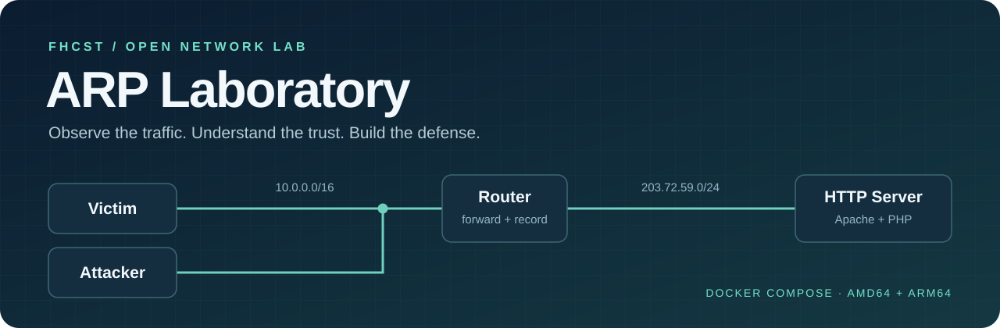

<div align="center">



<h1>ARP Laboratory</h1>
<p>用隔離的容器網路，練習 ARP Spoofing、封包驗證與路由器防護。</p>

<p>
<a href="https://github.com/fhcst/arp-laboratory/actions/workflows/images.yml"></a>
<a href="https://github.com/fhcst/arp-laboratory/pkgs/container/arp-laboratory-attack"></a>
<a href="LICENSE"></a>
<a href="docs/LICENSE.md"></a>

</p>

<p>
<a href="docs/handouts/student-handout.pdf">Windows 學生手冊 PDF</a> ·
<a href="docs/handouts/student-handout-macos.pdf">macOS 學生手冊 PDF</a> ·
<a href="docs/architecture.md">網路與群組設定</a> ·
<a href="CONTRIBUTING.md">參與貢獻</a>
</p>

</div>

## 先下載學生手冊

兩份手冊都有封面、目錄、操作截圖與實驗驗收步驟，適合學生在自己的電腦預習。內容涵蓋環境啟動、桌面連線、帳密確認、重新錄製與 PCAP 判讀。

| 平台 | 排版 PDF | Markdown | Markdown 與圖片套件 |
| --- | --- | --- | --- |
| Windows | [開啟 PDF](docs/handouts/student-handout.pdf) | [閱讀](docs/handouts/student-handout.md) | [下載 ZIP](docs/handouts/student-handout-markdown.zip) |
| macOS | [開啟 PDF](docs/handouts/student-handout-macos.pdf) | [閱讀](docs/handouts/student-handout-macos.md) | [下載 ZIP](docs/handouts/student-handout-macos-markdown.zip) |

## 快速啟動

準備 **Docker Engine 28.1 或更新版**與 **Docker Compose 2.36 或更新版**，並使用 Linux 容器。Windows 使用 Docker Desktop 的 WSL 2 後端。macOS 依手冊建立 Lima rootful Docker VM，從共享專案目錄操作。

```bash
git clone https://github.com/fhcst/arp-laboratory.git
cd arp-laboratory
docker compose up -d
docker compose ps
docker compose logs --tail 10 g01-victim
```

預設啟動第 1 組，會從 GHCR 拉取對應 CPU 架構的映像。看到 victim 印出 `index -> login -> admin action -> logout OK`，代表首頁、登入、面板操作及登出流程已跑通。

| 入口 | 預設值 |
| --- | --- |
| 瀏覽器 noVNC | `http://127.0.0.1:6080/vnc.html`，VNC 密碼 `labvnc01` |
| 原生 VNC | `vnc://127.0.0.1:15901`，使用同一組 VNC 密碼 |
| Windows RDP | `mstsc /v:127.0.0.1:13389`，選 Xorg |
| SSH | `ssh -p 2222 student@127.0.0.1` |
| 桌面與 SSH 帳密 | `student` / `demo-desktop-password` |
| 容器內實驗網站 | `http://203.72.59.10/` |
| 實驗網站帳密 | `admin` / `demo-http-password` |

可複製 `.env.example` 為 `.env`，調整密碼、連接埠、victim 間隔與映像標籤。這些是明文 HTTP 教學使用的示範帳密。遠端課程的主機連線方式與組別管理見 [安全性說明](SECURITY.md)。

## 實驗內容

**實驗一**讓 ARP Spoofing 在自己的隔離組別中生效。以鄰居項目與 ARP 封包佐證攻擊，再從 router 的錄製檔找出 victim 的登入 POST，核對其中的帳號與密碼。

**實驗二**沿用同一環境，在 router 偵測攻擊並實作防護。記錄告警、防護生效的截止時間與觀察區間，驗證截止後仍有 victim 測試流量，且 PCAP 中沒有新的登入帳密。

開始前先用 Firefox 確認網站帳密並登出，再通知 router 開一份新的錄製檔。

```bash
docker compose kill -s SIGUSR1 g01-router
docker compose logs --tail 10 g01-router
```

完成兩項實驗後停止環境。router 會結束錄製，每次錄製的 `lan.{timestamp}.pcap` 已保存在主機的 `captures/g01/`，檔名時間為 UTC。

```bash
docker compose down
```

精確的 Wireshark 篩選器、登入 POST 的表單欄位與交付證據，請依學生手冊第 6、7 步操作。

## 容器與網路

| 服務 | 實驗位址 | 內容 |
| --- | --- | --- |
| router | `10.0.10.254/16`、`203.72.59.254/24` | netshoot、轉發、nftables、持續錄製 |
| server | `203.72.59.10/24` | Ubuntu 26.04、Apache、PHP |
| victim | `10.0.0.10/16` | Ubuntu 26.04、自動網站操作循環 |
| attack | `10.0.0.20/16` | Ubuntu 26.04、Python、Scapy、Firefox、XFCE、VSCodium、SSH、RDP、VNC、noVNC |
| access | `10.0.0.30/16` | 將本機管理入口轉接到攻擊端 |

LAN、WAN 與管理網路依組別隔離。不同組可沿用相同的實驗 IPv4，每組的 ULA 子網與主機連接埠各自獨立。啟用第 2 組時，取消 `compose.yaml` 中 `compose.g02.yaml` 的註解，再執行 `docker compose up -d`。

[拓撲、平台範圍與增減組別](docs/architecture.md)

## 映像與本機建置

五個映像使用相同標籤，預設為 `latest`。需要固定課堂版本時，在 `.env` 設定 `LAB_IMAGE_TAG=sha-<完整提交值>`。

| 映像 | 套件頁面 |
| --- | --- |
| `ghcr.io/fhcst/arp-laboratory-router` | [router](https://github.com/fhcst/arp-laboratory/pkgs/container/arp-laboratory-router) |
| `ghcr.io/fhcst/arp-laboratory-access` | [access](https://github.com/fhcst/arp-laboratory/pkgs/container/arp-laboratory-access) |
| `ghcr.io/fhcst/arp-laboratory-server` | [server](https://github.com/fhcst/arp-laboratory/pkgs/container/arp-laboratory-server) |
| `ghcr.io/fhcst/arp-laboratory-victim` | [victim](https://github.com/fhcst/arp-laboratory/pkgs/container/arp-laboratory-victim) |
| `ghcr.io/fhcst/arp-laboratory-attack` | [attack](https://github.com/fhcst/arp-laboratory/pkgs/container/arp-laboratory-attack) |

修改容器程式時，可用單組本機建置模式。

```bash
docker compose -f compose.yaml -f compose.build.yaml up -d --build
```

停止本機建置的環境時也使用同一組 `-f` 參數。GitHub Actions 會在 `main` 更新時建置兩種架構、執行操作檢查，再發布多架構映像。每個映像均帶有連結本 repo 的 OCI source 標籤。

[開發、建置與發布流程](docs/development.md)

## 資料夾

```text
arp-laboratory/
├── compose.yaml                # 預設 GHCR 入口，選擇要啟用的組別
├── compose.g01.yaml            # 每組服務與隔離網路
├── compose.g02.yaml
├── compose.services.yaml       # 各組共用的執行設定
├── compose.build.yaml          # 第 1 組本機建置 override
├── containers/                 # 五個映像的 Dockerfile 與程式
├── captures/                   # 每組 PCAP，自動寫入並排除版本控制
├── docs/handouts/              # Windows、macOS PDF、Markdown、圖片、ZIP
├── docs/assets/                # 原創 banner
└── scripts/                    # 專案與容器驗證
```

## 貢獻與授權

歡迎透過 Fork 與 Pull Request 修正程式和教材。程式及 Compose 採 MIT，`docs/` 原創教材採 CC BY 4.0。第三方軟體與素材保留各自的授權。

[貢獻指南](CONTRIBUTING.md) · [行為準則](CODE_OF_CONDUCT.md) · [安全性回報](SECURITY.md) · [MIT](LICENSE) · [教材授權](docs/LICENSE.md) · [第三方聲明](THIRD_PARTY_NOTICES.md)
