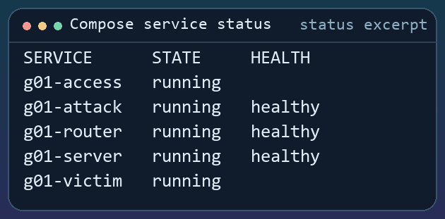
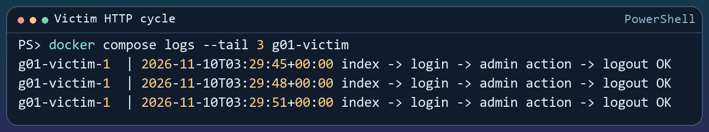
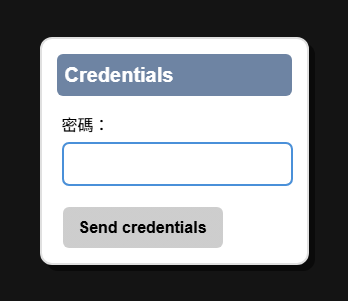
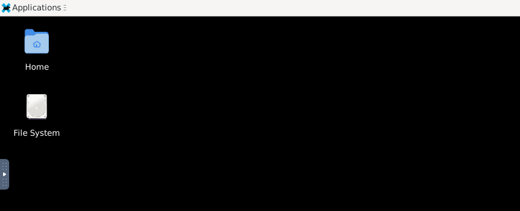
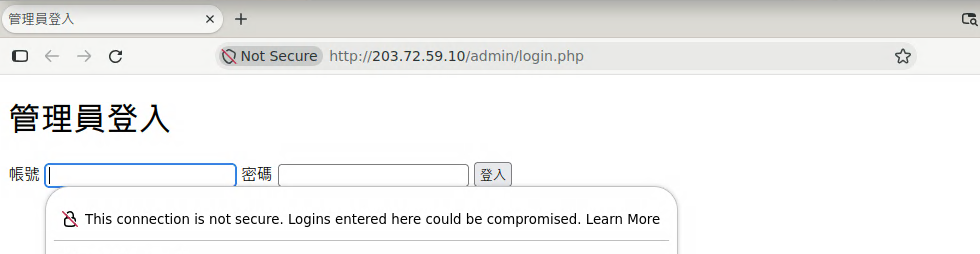
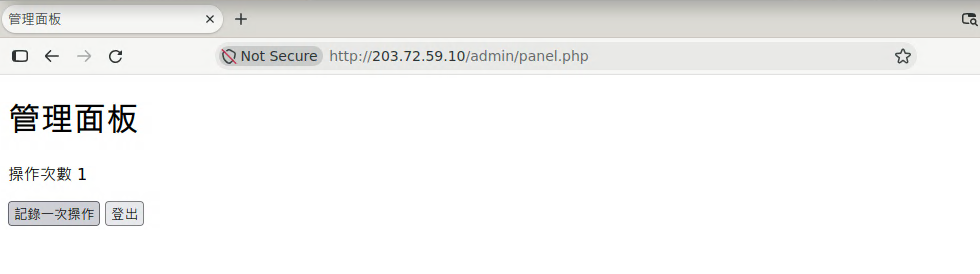
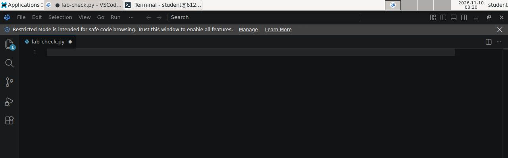
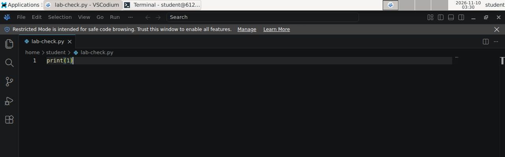
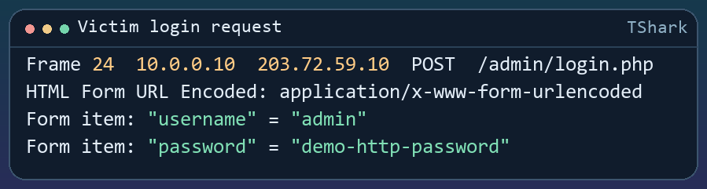

# ARP 實驗環境建置手冊

**macOS 自行建置 · 學生版 · 第 1 組 g01**

從啟動、登入與抓包，到驗證 ARP Spoofing 前後的封包變化。

| 課堂任務 | 需要留下的證據 |
| --- | --- |
| 實驗一　ARP Spoofing | 截止前可辨識的受害端登入帳密 |
| 實驗二　路由器偵測與防護 | 告警紀錄，以及截止後仍有流量但無登入帳密的 PCAP |


*FHCST · 教材採 CC BY 4.0 授權。*

<!-- page -->

## 目錄

| 步驟 | 內容 | 頁碼 |
| --- | --- | ---: |
| 1 | 準備 Mac、Lima 和專案 | 03 |
| 2 | 啟動並確認受害端正常運作 | 04 |
| 3 | 從 Mac 連到攻擊端桌面 | 05 |
| 4 | 確認網站與核對帳密 | 06 |
| 5 | 確認編輯器和 SSH | 07 |
| 6 | 兩項實驗與驗收 | 08 |
| 7 | 停止錄製並檢查 PCAP | 09 |
| 8 | 卡住時先查哪裡 | 10 |

### 開始前先確認

本手冊以 macOS 上的 Lima Linux 虛擬機為例。用 Mac 終端機啟動 Lima，在 Linux shell 執行 Docker，再回到 Mac 瀏覽器或螢幕共享登入。如果老師已提供遠端入口，直接從第 3 步使用老師給的連線資料。畫面中的 XFCE、Firefox 與 VSCodium 都是攻擊端容器的介面。

<!-- page -->
## 1. 準備 Mac、Lima 和專案

從專案頁選 **Code → Download ZIP**，解壓縮到 Mac 家目錄並命名為 `arp-lab`。 `~/arp-lab` 這一層要能看到 `compose.yaml`。 [ARP Laboratory 專案](https://github.com/fhcst/arp-laboratory)

在 **Mac 終端機**安裝 Lima。若 `brew` 找不到，先依 Homebrew 官方步驟安裝並設定 PATH。 [Homebrew 安裝](https://brew.sh/) · [Lima 安裝](https://lima-vm.io/docs/installation/)


```bash
brew install lima
cd "$HOME/arp-lab"
ls compose.yaml
limactl start --name=arp-lab --vm-type=vz --mount-only "$PWD:w" \
  --cpus=4 --memory=4 --disk=30 template:docker-rootful
```

看到選單時選 **Proceed with the current configuration**。這台 Linux VM 使用 **rootful Docker** 建立 macvlan，並把 Mac 上的專案資料夾掛成可寫入。 [Lima Docker 範本](https://lima-vm.io/docs/examples/containers/docker/) · [Lima 掛載選項](https://lima-vm.io/docs/reference/limactl_start/)

如果先前用 `--mount-none` 建過同名 VM，先停止舊的 Compose 環境。在 **Mac 終端機**的專案目錄執行：


```bash
limactl stop arp-lab
limactl edit arp-lab --mount-only "$PWD:w"
limactl start arp-lab
```

從 **Mac 終端機**進入共享資料夾。第一行執行後，後三行是在 **Lima 的 Linux shell** 執行。


```bash
limactl shell --workdir "$PWD" arp-lab
test -w . && ls compose.yaml && mkdir -p captures/g01
docker version
docker compose version
```

確認看得到 `compose.yaml`、Docker 有 **Server** 區塊，且 Compose 為 **2.36 或更新版**。後續重新開機時，從 Mac 的專案目錄執行 `limactl start arp-lab`，再用上方指令進入 VM。 [Compose 網卡命名需求](https://docs.docker.com/reference/compose-file/services/#interface_name)

<!-- page -->

## 2. 啟動並確認受害端正常運作

在 **Lima 的 Linux shell**，在剛才進入的共享專案資料夾執行。第一次會從 GHCR 下載適合 CPU 架構的預先建置映像，等指令返回後再檢查狀態。

```bash
docker compose config --services
docker compose up -d
docker compose ps
```

預設啟動 `g01`，服務清單會有下表五項。名稱以 `g01-` 開頭是為了區分各組。

| 服務 | 實驗 IPv4 | 用途 |
| --- | --- | --- |
| `g01-victim` | `10.0.0.10/16` | 自動造訪網站，產生 HTTP 流量 |
| `g01-attack` | `10.0.0.20/16` | 學生登入操作的 XFCE 桌面 |
| `g01-router` | `10.0.10.254/16`、`203.72.59.254/24` | 連接內外網並抓包 |
| `g01-server` | `203.72.59.10/24` | 提供實驗網站 |
| `g01-access` | `10.0.0.30/16` | 轉接 noVNC、VNC、SSH 與 RDP |



*圖 2　節錄 Linux 引擎實測的 Service、State 與 Health 欄。*

```bash
docker compose logs --tail 10 g01-victim
```

看到 `index -> login -> admin action -> logout OK` 才算網站流程跑通。若清單只有空白，等幾秒再執行一次。



*圖 3　受害端每次完成整套流程，就會新增一行 OK。*

<!-- page -->

## 3. 從 Mac 連到攻擊端桌面

### 方法 A｜瀏覽器 noVNC

回到 **Mac 的瀏覽器**，開啟 `http://127.0.0.1:6080/vnc.html`。按 **連線（Connect）**，輸入第 1 組的 **VNC 密碼** `labvnc01`。若老師已改過密碼，使用配發的值。noVNC 的 XFCE 桌面已使用 `student` 身分啟動。



*圖 4　按連線後輸入 VNC 密碼，再選 Send credentials。*



*圖 5　連上後可以在瀏覽器操作 XFCE。*

### 方法 B｜macOS 內建螢幕共享

在 **Mac 終端機**執行，然後在螢幕共享視窗輸入同一組 VNC 密碼。 [Apple 螢幕共享指南](https://support.apple.com/guide/mac-help/share-the-screen-of-another-mac-mh14066/mac)

```bash
open 'vnc://127.0.0.1:15901'
```

兩種方式共用同一個 XFCE 工作階段。VNC 密碼與 SSH、實驗網站密碼各自獨立。若課堂使用教師主機，請依教師提供的入口連線。

<!-- page -->
## 4. 確認網站與核對帳密

1. 從 XFCE 的 **Applications** 開啟 **Firefox**。若出現首次使用畫面，完成設定後，在網址列輸入 `http://203.72.59.10/`，確認看到「ARP 實驗網站」。
2. 開啟 `http://203.72.59.10/admin/login.php`，用自己的**實驗網站帳密**登入。本機預設帳號為 `admin`，密碼為 `demo-http-password`。若你在 `.env` 改過設定，使用 `LAB_WEB_USER` 與 `LAB_WEB_PASSWORD` 的實際值。



*圖 6　先確認這組網站帳密能登入，稍後用它核對封包中的欄位。*

3. 進入「管理面板」後，點一次「記錄一次操作」，確認計數增加，再按「登出」。第 6 步會重啟錄製，把這次手動登入留在舊檔。



*圖 7　看到管理面板並能操作計數，即完成開始前的網站檢查。*

<!-- page -->

## 5. 確認編輯器和 SSH

公開映像預裝 **VSCodium**，這是基於 Code - OSS 的 MIT 編輯器。在 XFCE 的 **Applications** 開啟 VSCodium，或在 **XFCE 終端機**用下列指令開一個 Python 檔。專案提供的 `code` 指令會啟動 VSCodium。

```bash
code ~/lab-check.py
```



*圖 8a　code 指令會在 VSCodium 開啟指定的檔案。*

切到 `lab-check.py` 分頁，可先輸入 `print(1)` 並按 Ctrl+S 儲存，確認檔案可編輯。使用 SSH 執行需要原始封包權限的程式時，可依實驗需求使用 sudo。



*圖 8b　輸入並儲存簡單的 Python 敘述，確認編輯器可用。*

如果老師已提供遠端環境，SSH 請使用老師提供的主機和 SSH 埠，或直接使用已登入的 XFCE。若在自己電腦建置，可另開一個 **Mac 終端機** 視窗，用 SSH 連入同一台攻擊端。

```bash
ssh -p 2222 student@127.0.0.1
```

第一次連線若詢問是否信任主機金鑰，先確認連的是剛建立的本機容器，再輸入 `yes`。重建後若出現主機金鑰已變更，也要先核對目標，確認是自己剛重建的本機實驗後，可用 `ssh-keygen -R '[127.0.0.1]:2222'` 清除舊記錄再重連。登入後，在 **SSH 工作階段**執行：

```bash
whoami
python3 --version
python3 -c "import scapy; print(scapy.__version__)"
exit
```

`whoami` 應顯示 `student`，後兩個指令分別顯示 Python 和 Scapy 版本。`exit` 會回到 Mac 終端機。

<!-- page -->
## 6. 兩項實驗與驗收

### 先開一份新的錄製

完成第 4 步的手動登入與登出後，在 **Lima 的 Linux shell** 的專案根目錄執行。第一行送出 `SIGUSR1`，只重啟錄製程序。


```bash
docker compose kill -s SIGUSR1 g01-router
docker compose logs --tail 10 g01-router
docker compose logs --since 30s --timestamps g01-victim
```

第一行可能顯示 `Killed`，表示 Compose 已送出指定的訊號。等 router 紀錄出現新的 `Recording` 行，記下兩項實驗共用的 `lan.{timestamp}.pcap`。檔名時間是 UTC。確認 victim 在新檔建立後出現 `logout OK`，再從攻擊端的 XFCE 終端機開始實驗。兩項實驗之間維持錄製。

### 實驗一｜實作 ARP Spoofing

讓受害端將攻擊端的 MAC 誤認為預設閘道，也讓路由器將攻擊端的 MAC 誤認為受害端。記下攻擊開始時間和鄰居項目的變化，確認 victim 仍能完成網站流程。router 平時就能看到明文 HTTP，請一併保留鄰居項目變化或偽造的 ARP 回覆作為攻擊證據。

**驗收目標**　用第 7 步的篩選器找出攻擊期間受害端的登入 POST，記下封包編號與時間，並將表單的帳密與第 4 步已驗證的值比對。

### 實驗二｜在原環境加入路由器防護

沿用同一組容器、IP、網站與錄製檔。讓 router 偵測 ARP Spoofing 並採取防護。記下告警時間、防護生效的**截止時間**與觀察結束時間，並在觀察區間內持續攻擊及 victim 測試。保留告警及防護命中的證據。

**驗收目標**　截止前找得到受害端的登入帳密。截止後在同一份 PCAP 仍可看到受害端的測試流量，例如嘗試連線的 TCP SYN，但看不到新的登入帳密。若 router 在 `lan0` 仍錄到完整表單，即使轉發已遭阻擋，PCAP 仍可讀到帳密。

<!-- page -->
## 7. 停止錄製並檢查 PCAP

在 **Lima 的 Linux shell** 停止 Compose。router 會結束錄製，PCAP 已在 Mac 的共享專案資料夾中。


```bash
docker compose down
exit
```

在 **Mac 終端機**開啟抓包資料夾。若自訂 `ARP_LAB_ENV_G01_NAME`，把路徑中 `captures/g01` 的 `g01` 改成自訂名稱。


```bash
open "$HOME/arp-lab/captures/g01"
limactl stop arp-lab
```

### 在 Wireshark 找到登入表單

在主機安裝 Wireshark，開啟第 6 步記下的檔案。將下列整行貼到 **顯示篩選器**並按 Enter。 [Wireshark 下載](https://www.wireshark.org/download.html)


```text
ip.src == 10.0.0.10 && ip.dst == 203.72.59.10 && http.request.method == "POST" && http.request.uri == "/admin/login.php"
```

1. 在封包清單選取**攻擊開始後、截止前**的 `POST /admin/login.php`。來源是 victim `10.0.0.10`，目的地是網站 `203.72.59.10`。手動核對帳密的來源是攻擊端 `10.0.0.20`。
2. 在封包詳細資料展開 **HTML Form URL Encoded**，查看 `username` 和 `password`。也可右鍵選 **Follow → TCP Stream**，在 `POST /admin/login.php` 下方找表單本文。開登入頁的 GET 與操作面板的 POST 都是其他請求。
3. 用同一篩選器檢查截止後是否仍有帶帳密的登入 POST。要確認該區間仍有連線嘗試，可用 `ip.src == 10.0.0.10 && ip.dst == 203.72.59.10 && tcp.dstport == 80 && tcp.flags.syn == 1 && tcp.flags.ack == 0`。



*圖 9　測試 PCAP 的表單解碼。請依自己的攻擊時間找出對應封包。*

交付 PCAP、登入封包編號與時間、帳密核對結果、告警與截止時間，以及截止後仍有測試流量的證據。比對時間前，先確認 Wireshark 和實驗筆記採用相同時區。

<!-- page -->

## 8. 卡住時先查哪裡

| 現象 | 先檢查這一項 |
| --- | --- |
| `limactl: command not found` | 在 Mac 終端機執行 `brew install lima`，確認 Homebrew 的 PATH 已生效。 |
| `docker: command not found` 或連錯 Docker | 用第 1 步的 `limactl shell --workdir "$PWD" arp-lab` 進到 Linux，再執行 Docker 指令。 |
| `no configuration file provided` | 從 Mac 的專案目錄重新進入 Lima，確認共享目錄可寫入，且看得到 `compose.yaml`。 |
| `macvlan` 建立失敗 | 確認使用 `docker-rootful` 的 Linux VM。記下完整錯誤與 `docker version` 給老師。 |
| Mac 的 noVNC 打不開 | 在 Linux 查 `g01-access` 和 `g01-attack`；再從 Mac 測試下方的 TCP 埠。 |
| Mac 的本機埠已被使用 | 改專案 `.env` 中的 `LAB_NOVNC_PORT_G01` 或 `LAB_VNC_PORT_G01`，再執行 `docker compose up -d`。若沒有 .env，可先用 cp .env.example .env 建立。用新的主機埠連線。 |
| noVNC 或 VNC 提示密碼錯誤 | 使用 VNC 的 8 碼密碼。自行設定時可在 `.env` 修改 `LAB_VNC_PASSWORD_G01`，再執行 docker compose up -d 套用。 |
| 受害端一直重試 | 在 Linux 查看 `g01-router`、`g01-server`、`g01-victim` 的紀錄。 |

在 **Lima 的 Linux shell**：

```bash
docker compose ps -a
docker compose port g01-access 6080
docker compose logs --tail 30 g01-attack g01-access
```

在 **Mac 終端機**：

```bash
nc -vz 127.0.0.1 6080
nc -vz 127.0.0.1 15901
```

Lima 會將 Linux 的本機埠轉到 Mac 的本機。自訂埠後，`docker compose port` 輸出右側是 Linux 的主機埠，Mac 自動轉接預設使用相同埠號。 [Lima 連接埠轉發](https://lima-vm.io/docs/config/port/)

### 完成檢查

- [ ] 五個服務都已啟動，victim 至少有一行 `logout OK`。
- [ ] 能從 Mac 登入 XFCE，並在開始錄製前核對網站帳密。
- [ ] 能在 Mac 開啟實驗用 `lan.{timestamp}.pcap`，並核對兩階段的證據。
